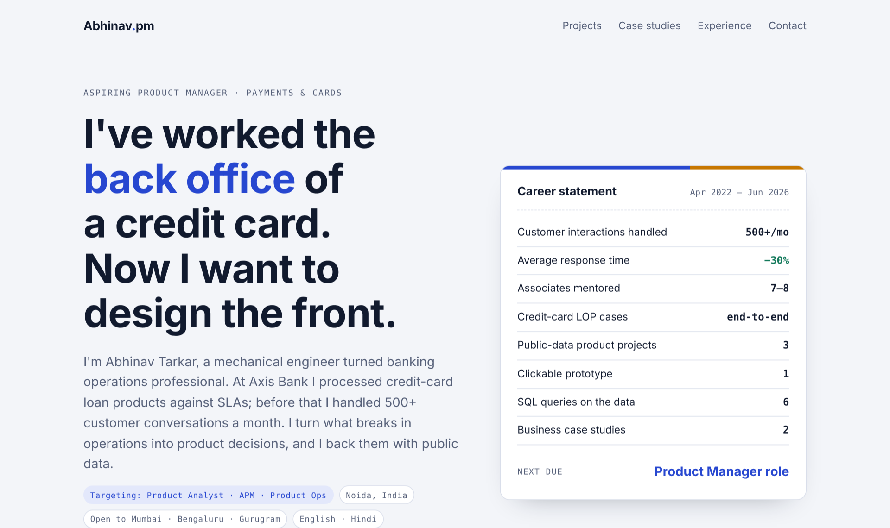

# Abhinav Tarkar · Product Portfolio

Portfolio website of **Abhinav Kumar Tarkar**, aspiring Product Manager in payments and cards (Noida, India).
Banking operations at Axis Bank (credit-card Loan-on-Product processing) and customer experience at iEnergizer, turned into data-led product work.

**Live site:** https://abhinavspambox.github.io/



## Projects (public RBI / NPCI data)

| Project | Question | Data |
|---|---|---|
| [Card Pulse](projects/card-pulse/) | Are banks issuing credit cards faster than people use them? | RBI card statistics, Jan–Sep 2026 |
| [UPI × Credit](projects/upi-credit/) | How can a premium card issuer take part in small-ticket UPI spending? | NPCI UPI statistics, Jan–Oct 2026 |
| [Complaint Radar](projects/complaint-radar/) | Can better dispute visibility keep credit-card complaints away from the RBI Ombudsman? | RBI Ombudsman Annual Report 2024-25 |

Each project folder has a dashboard (`index.html`), the dataset (`data.csv`, every row with its source link) and a Python script (`analysis.py`, standard library only) that reproduces every number.

**Also included**
- [Dispute tracker prototype](projects/complaint-radar/prototype.html): clickable prototype for Complaint Radar, with a 5-task usability test plan.
- [Discovery plans](projects/card-pulse/index.html#discovery): hypotheses, how each will be tested and what would change my mind, plus an interview guide.
- [SQL workbench](sql/index.html): all datasets in SQLite with six queries (joins, CTEs, window functions). Run `python sql/run.py`.

## Open-source product

- [Munshi CRM](projects/munshi-crm/): a free, open-source sales CRM I designed and built. It captures every website signup as a lead, follows up automatically and tracks deals to the end. Demo video on the page; code at [abhinavspambox/munshi-crm](https://github.com/abhinavspambox/munshi-crm).

## Case studies

- [CRED](case-studies/cred.html): can a rewards app for good borrowers become a profitable lender?
- [American Express in India](case-studies/amex-india.html): winning premium customers in a UPI-first market.

## Data provenance

Figures were compiled from press reports of official releases. To verify or refresh them, use the originals:
- RBI Bank-wise ATM/POS/Card Statistics: https://rbi.org.in/Scripts/ATMView.aspx
- NPCI monthly metrics: https://www.npci.org.in/statistics/monthly-metrics
- RBI Annual Report of the Ombudsman Scheme 2024-25: https://rbi.org.in/Scripts/PublicationsView.aspx?id=23441

## Standalone repositories

Each project also lives in its own repository: [card-pulse](https://github.com/abhinavspambox/card-pulse) · [upi-credit](https://github.com/abhinavspambox/upi-credit) · [complaint-radar](https://github.com/abhinavspambox/complaint-radar) · [sql-workbench](https://github.com/abhinavspambox/sql-workbench) · [india-payments-data](https://github.com/abhinavspambox/india-payments-data) · [munshi-crm](https://github.com/abhinavspambox/munshi-crm)

## Run locally

```bash
python -m http.server 8000      # then open http://localhost:8000
python projects/card-pulse/analysis.py
python sql/run.py               # builds sql/portfolio.db and prints all query results
```

## Structure

```
index.html                     portfolio home page
projects/card-pulse/           dashboard + data + analysis
projects/upi-credit/
projects/complaint-radar/       (+ prototype.html)
sql/                           schema.sql, queries.sql, run.py, index.html
case-studies/                  cred.html, amex-india.html
```

Figures come from public RBI and NPCI releases as reported in the press and are used for portfolio analysis only. Product proposals are personal ideas and do not reflect any employer's plans.
